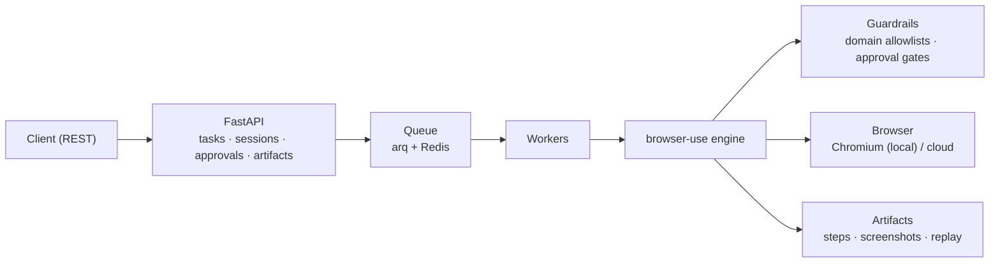

# Cortex-OS

**A production-grade browser agent service.** Give it a task in plain English — it
drives a real browser and does it: navigates, clicks, fills forms, extracts data,
downloads files. Powered by [browser-use](https://github.com/browser-use/browser-use).

Not a chatbot. An intent-to-action system for the web.

---

## What it does

```
POST /tasks {"task": "go to github.com/browser-use/browser-use and report the star count"}
        → a real browser opens → the agent works → result + full step-by-step replay
```

Every task produces a complete audit trail: per-step actions, page snapshots,
screenshots, and the agent's reasoning — replayable end to end.

## Architecture



Deep background reading on how browser agents work lives in
[`docs/browser-agents/`](docs/browser-agents/README.md) — perception models, control
channels, framework landscape, and why this design was chosen.

## Quickstart

```bash
conda create -n cortex python=3.12 -y
conda activate cortex
uv add --all   # or: uv sync
cp .env.example .env   # fill in OPENAI_API_KEY
uvx browser-use install
uvicorn cortex.main:app --app-dir src
arq cortex.worker.WorkerSettings   # in a second shell
```

Then:

```bash
curl -X POST localhost:8000/tasks \
  -H 'Content-Type: application/json' \
  -d '{"task": "Open example.com and tell me the page heading"}'
```

## Status

Under construction — P0 (core loop) → P1 (safety & state) → P2 (observability) →
P3 (scale & evals). See repo docs for the roadmap.
