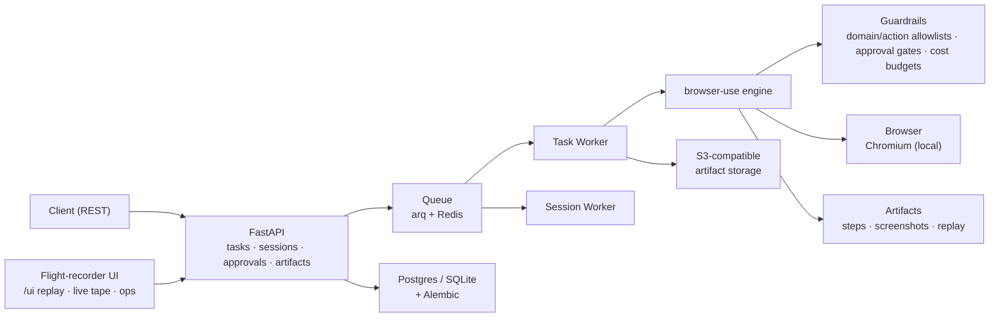

# Cortex-OS

**A production-grade browser agent service.** Give it a task in plain English — it
drives a real browser and does it: navigates, clicks, fills forms, extracts data.
Powered by [browser-use](https://github.com/browser-use/browser-use).

Not a chatbot. An intent-to-action system for the web.

## What it does

```
POST /tasks {"task": "go to github.com/browser-use/browser-use and report the star count"}
        → a real browser opens → the agent works → result + full step-by-step replay
```

Every task produces a complete audit trail: per-step actions, page snapshots,
screenshots, token/cost telemetry — replayable end to end.

## Watch it work

Open `http://127.0.0.1:8901/ui/` — the flight-recorder UI: task rail with live
status, a tape panel that auto-advances step screenshots while the agent runs
(scrub back through frames), approvals inbox (approve/deny), cancel/resume,
and `/ui/ops.html` for fleet stats.

## Architecture



## Quickstart

Requires: Python 3.12, Redis, `OPENAI_API_KEY`.

```bash
conda create -n cortex python=3.12 -y && conda activate cortex
uv sync --all-extras --dev          # or: uv pip install -e '.[dev]'
cp .env.example .env                 # set OPENAI_API_KEY (+ VAULT_FERNET_KEY if using credentials)
uv run browser-use install chromium

# terminal 1 — API
uv run uvicorn cortex.main:app --host 127.0.0.1 --port 8901 --app-dir src

# terminal 2 — task worker
uv run arq cortex.worker.WorkerSettings --app-dir src

# optional terminal 3 — session worker (for /sessions/{id}/open headed logins)
uv run arq cortex.worker.SessionWorkerSettings --app-dir src
```

First task:

```bash
curl -X POST localhost:8901/tasks \
  -H 'Content-Type: application/json' \
  -d '{"task": "Open example.com and tell me the page heading"}'
# → {"id": "...", "status": "queued", ...}

curl localhost:8901/tasks/<id>          # status + result
curl localhost:8901/tasks/<id>/events   # full transition + step trail
```

## Auth

Optional but recommended outside dev: `REQUIRE_API_KEY=true`.

- **Seed keys** — `API_KEYS=dev-key-1,dev-key-2` env; seeded hashed into the DB at boot.
- **Managed keys** — `POST /admin/keys {"label": "ci"}` returns a `ctx_…` key exactly
  once (stored sha256-only). List labels/stats via `GET /admin/keys`; revoke via
  `DELETE /admin/keys/{id}`; per-key `daily_limit` → 429 on exhaustion.
- Send as `X-API-Key: <key>`.

## Safety & reliability

- **Allowlists** — `allowed_domains`, `allowed_actions` (read-only vs transactional).
- **Human gates** — `approval_domains`, `approval_actions` → pause + `/approvals`.
- **Escalation** — two-tier wall detection (widget signatures always fire; keyword phrases suppressed on prose/login pages — no false pauses on articles) → `waiting_human` + webhook → `POST /tasks/{id}/resume`.
- **Anti-wander** — prompt rule + runtime `tool_loop` stop (5 identical actions → typed failure).
- **Retries** — transient failures retry with backoff; exhausted → `dead_letter:`.
- **Durable resume** — worker restart re-queues active tasks with a replay checkpoint; orphaned Chromium is reaped.
- **Budgets** — `max_tokens` per task (`cost_exceeded`), `task_timeout_s`, `max_steps`.
- **Backpressure** — `MAX_QUEUED_TASKS` → 429 + `Retry-After`; `RATE_LIMIT_PER_DOMAIN_S`.
- **Observability** — `/tasks/{id}/events`, `/stats`, OTel traces (`OTEL_EXPORTER_OTLP_ENDPOINT`, Jaeger via `docker compose --profile tracing`).

## Docker

```bash
cp .env.docker .env.docker.local  # set OPENAI_API_KEY
docker compose up                 # api :8901 + worker + redis + postgres + s3mock
```

Containers run non-root; artifacts go to S3Mock, DB to Postgres.

## Evaluation & evidence

Three suites:

```bash
python -m evals.run            # local fixtures incl. injection bait — needs API key
python -m evals.bench --model gpt-5-mini --limit 15  # Online-Mind2Web public tasks
python -m evals.redteam.run    # 27 attack pages, wall-detector coverage — free, CI-gated
```

- **`evals.run`** — deterministic local fixture pages; content + leak checks.
- **`evals.bench`** — public benchmark runner (status, steps, tokens, $, failure category; `--compare`, `--autojudge`). 15 easy tasks × OpenAI models: `gpt-5-mini` = `gpt-5-nano` at 26.7%, nano ~5× cheaper.
- **`evals.redteam`** — attack library (wall spoofs, injection bait, nav traps); 16/16 offline coverage.

Most self-hosted agents score ~30% on live sites — failures are auto-classified
(bot-blocked, wandering, timeouts) rather than hidden.

## Tests

```bash
uv run pytest -q
uv run ruff check src tests alembic evals
```

*Built to answer one question: can a browser agent be operated, measured, and
audited like production software?*
